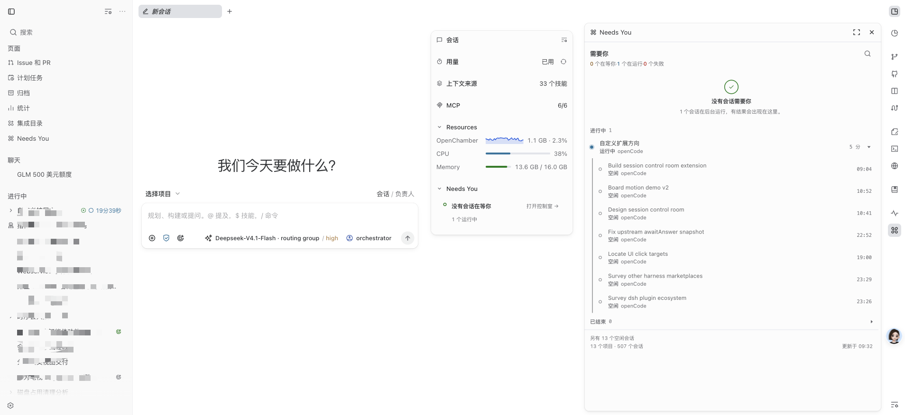
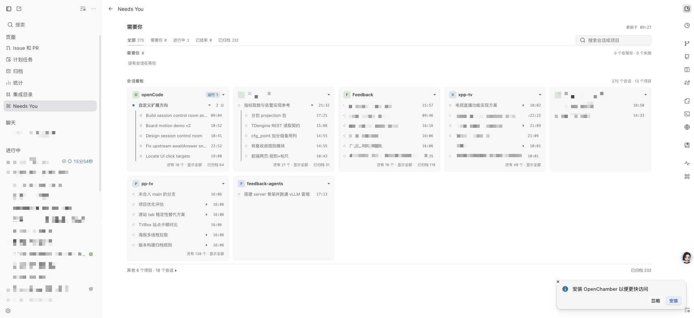

# Needs You（OpenChamber extension）

An [OpenChamber](https://openchamber.dev) extension that compresses the dozens of background sessions across ~20 projects into one question: **which one is waiting on me right now?**

The Needs You only reads the sessions OpenChamber is already running — no second runtime.

[中文](README.md) · English

## Screenshots




## What it does

The sidebar is organised by project: it answers "which sessions does this project have". The question you actually ask is "which project is waiting on me". Those are transposes of each other, and the Needs You only performs that transpose:

- **Rail panel** — a cross-project queue. "Waiting on you" is always at the top, and the right of each row is **how long it has been waiting**, not when it last changed.
- **Full page** (sidebar › Pages › Needs You) — a board laid out by project. A project with a blocked session always sorts first; you see where everything is stuck at a glance.
- **Work Status strip** — one line visible without opening anything. With zero blocked sessions it still reports failures: it never calls "something failed" all clear.

v1 is **read-only**: clicking a row opens that session (`openSession`). Nothing else — no new sessions, no approving permissions, no reading conversations or files.

## The state language

The host gives two orthogonal fields: `activity` (what is happening now) and `outcome` (how the last turn ended). The Needs You folds them into 8 drawable states, redundant in shape + colour + text:

| State                 | Shape                         | Colour | Trigger                                                  |
| --------------------- | ----------------------------- | ------ | -------------------------------------------------------- |
| Permission / Question | filled dot + expanding halo   | amber  | `waiting-permission` / `waiting-question`            |
| Failed                | **rounded square**      | red    | `outcome: failed`, not running                         |
| Retrying              | filled dot + spinning gap arc | blue   | `retrying`                                             |
| Running               | filled dot + breathing ring   | blue   | `running`                                              |
| Done                  | hollow ring                   | green  | `idle` + `completed`                                 |
| Idle                  | hollow ring at 60%            | grey   | `idle`, no outcome                                     |
| Unknown               | dashed ring                   | grey   | `unknown` (never counted)                              |
| Archived              | 6px hollow ring, 60% opacity  | grey   | `archivedAt != null`, only in the board's Archived tab |

Failures never count as "waiting on you": nobody is waiting for a reply on `PR #42`; it just needs a look. Adding the two would make the badge and the summary disagree.

## Requirements

|              |                                                                                                                                                 |
| ------------ | ----------------------------------------------------------------------------------------------------------------------------------------------- |
| OpenChamber  | **2.3.3 or newer** (the manifest `engines` floor). Older hosts refuse with `host-too-old`.                                            |
| Platform     | Web and desktop. On a phone the panel becomes a workspace tab (`panel.mobile: true`); the Work Status strip shows where the host supports it. |
| VS Code      | **Does not load extensions.**                                                                                                             |
| Dependencies | None. No local service, no runtime npm dependency, no network request.                                                                          |

## Install

**From a folder (development)**: paste the repository path into OpenChamber → **Settings → Extensions** → *Folder, ZIP, or URL*:

```
/Users/simon/code/github/openchamber-needs-you
```

**From Git**:

```
https://github.com/SimonHeiHei/openchamber-needs-you
```

Or use the deep link, which opens the install dialog:

```
openchamber://extensions/install?url=https://github.com/SimonHeiHei/openchamber-needs-you
```

Approve the single capability (next section), reload once, and the radar icon appears on the rail.

## What it asks for

**One capability: `sessions`.** It lets the extension read the registered project list, each session's title and live state (`activity` / `outcome` / `archivedAt` / worktree branch), and open a session in the foreground.

That is all. **No local process, no network, no files, no credentials.** No `service`, no `integration`, no `filesystem`, no `origins`; the approval dialog shows exactly one row, `sessions`. The extension does not read conversation content — the host does not expose it — so the UI never claims to know what a session is waiting to approve; it only says it is waiting.

Two side effects, both inside the host: the rail badge is drawn by the host (`setBadge`), and preferences live in the extension's own `host.storage` namespace (seen blocked ids, collapsed cards, page filters). Uninstalling removes that namespace.

## How it works

```
host.listProjects() / onProjects ─┐
host.onSessions(projectId) ×≤31 ──┴─▶ normalise to rows ─▶ sort / count ─▶ panel · board · Work Status strip
                                        │
                                        ├─ blocked id not seen yet → setBadge(fresh count)
                                        └─ panel/page visible → mark seen + setBadge(null)

cr.seen  { ids, at }   ← blocked ids only (≤200)
cr.collapsed / cr.subs / cr.board  ← folding, swap-in/out, page filters
```

- At most 32 host subscriptions per iframe. The Needs You uses one `onProjects` plus up to 31 `onSessions`; projects beyond that are listed as "not connected" and can be swapped in by hand. **A project with waiting sessions is never swapped out.**
- A failed subscription never empties the queue: the last data stays, and a warning banner says "could not read N projects — some waits may be missing". Every non-ready state distinguishes "nothing" from "unknown".
- The badge counts only blocked sessions **that are new since the last time you looked**; failures never count. The panel still shows the real total: the badge is a reminder, the panel is the ledger.

## Development

```bash
npm install
npm run build      # esbuild: panel/main.js + status/main.js (IIFE; the host never compiles TS)
npm run check      # node --check both bundles + the manifest ship checklist
npm run typecheck  # tsc --noEmit
```

`panel/main.js` and `status/main.js` are **committed with the package**: OpenChamber installs from Git or a folder and never compiles TypeScript; a missing file fails install as `missing-build`. To ship an update, bump `version` (semver) and rebuild.

Source layout:

```
panel/src/main.ts     entry: onReady → theme/locale/surface → mount panel or page
panel/src/store.ts    snapshots, derived state, sorting, badge, subscription budget
panel/src/dom.ts      rows / sections / cards / Work Status strip
panel/src/style.ts    all CSS (host --oc-* tokens)
panel/src/strings.ts  zh/en strings
status/src/main.ts    Work Status strip (its own iframe, same store)
```

## Troubleshooting

| Symptom                                          | Cause / fix                                                                                                                                                                    |
| ------------------------------------------------ | ------------------------------------------------------------------------------------------------------------------------------------------------------------------------------ |
| Panel says "Sessions permission is not approved" | `NOT_GRANTED`. Approve `sessions` again in Settings → Extensions, then reopen.                                                                                            |
| Yellow banner "Could not read N projects"        | Some `onSessions` subscriptions were refused or timed out. The queue keeps its last data; press Retry. Counts may be low on purpose — it never pretends nothing is waiting. |
| Stuck on "Reading…"                             | The host has not pushed a project snapshot yet. Check OpenChamber ≥ 2.3.3 and that the extension is enabled.                                                                  |
| No entry in VS Code or an old version            | Extensions load on web and desktop only; VS Code is unsupported, and hosts below the `engines` floor refuse to install.                                                      |
| Badge number differs from the panel total        | Expected. The badge counts new waits; the panel counts all waits. Opening the panel clears the badge; failures never count.                                                    |
| A project shows "not connected"                  | Beyond the 31-project subscription budget, or you swapped it out. Use Manage / Swap in; a project with waiting sessions cannot be swapped out.                                 |
| There is no "open board" button in the panel     | Host limit: pages open only from the sidebar's Pages menu;`openSurface` cannot open `page`. A button that does nothing is worse than none.                                 |
| Code changed but the UI did not                  | Folder installs need `npm run build`; Git installs need a higher `version` and a reinstall.                                                                                |

## License

MIT. Inline icon paths come from [Remixicon](https://remixicon.com) (Apache-2.0); see [NOTICE](NOTICE).
