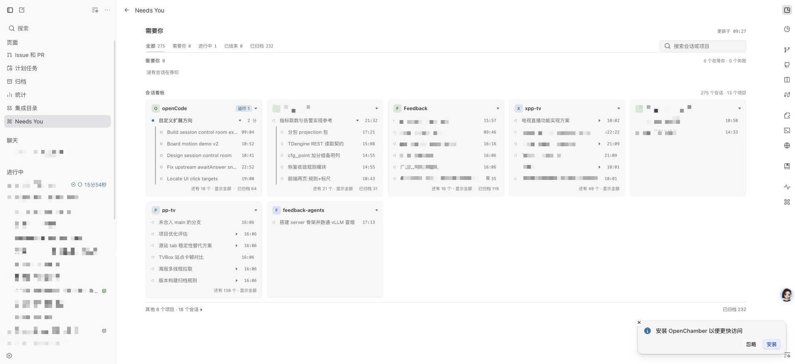

# 需要你 · Needs You（OpenChamber 扩展）

一个 [OpenChamber](https://openchamber.dev) 扩展：把二十来个项目里几十个后台会话，压成一条问题——**现在哪一个在等我？**

只做 OpenChamber 已经在跑的那些会话，不做第二套运行时。

中文 · [English](README.en.md)

## 截图预览




## 它解决什么

侧栏按项目组织，回答的是「这个项目的会话有哪些」；你真正要问的是「哪个项目在等我」。两者是转置关系。控制室只做这个转置：

- **侧栏面板**：跨项目的时间队列。「等你」永远在最上面，行右侧写的是**已经等了多久**，不是最后更新时间。
- **全屏看板**（侧栏 › 页面 › 需要你）：按项目铺开。有阻塞的项目永远排在最前，一眼看出全局停在哪。
- **Work Status 条**：不用点开扩展就能看见的一行。0 阻塞时仍然会说出失败数——不把「有失败」说成「一切正常」。

v1 是**只读**的：点一行跳到那个会话（`openSession`），没有别的动作。不新建会话、不批准权限、不读对话、不读文件。

## 状态语言

宿主给两个正交字段：`activity`（现在在干什么）和 `outcome`（上一轮的结果）。控制室折叠成 8 个可绘制状态，形状 + 颜色 + 文字三重冗余：

| 状态        | 形状                 | 颜色 | 触发                                             |
| ----------- | -------------------- | ---- | ------------------------------------------------ |
| 权限 / 提问 | 实心圆 + 扩散光环    | 琥珀 | `waiting-permission` / `waiting-question`    |
| 失败        | **圆角方块**   | 红   | `outcome: failed` 且不在运行                   |
| 重试中      | 实心圆 + 旋转缺口弧  | 蓝   | `retrying`                                     |
| 运行中      | 实心圆 + 呼吸环      | 蓝   | `running`                                      |
| 已完成      | 空心环               | 绿   | `idle` + `completed`                         |
| 空闲        | 空心环 60%           | 灰   | `idle` + 无结果                                |
| 未知        | 虚线环               | 灰   | `unknown`（不进任何计数）                      |
| 已归档      | 6px 空心环，整体 60% | 灰   | `archivedAt != null`，只在看板的归档标签里出现 |

「失败」永远不计入「在等你」：`PR #42` 没有人等你回复，它只是需要你看一眼。两者相加会让角标与文案互相打架。

## 环境要求

|             |                                                                                                                   |
| ----------- | ----------------------------------------------------------------------------------------------------------------- |
| OpenChamber | **2.3.3 或更高**（manifest 的 `engines` 下限）。更低版本会以 `host-too-old` 拒绝安装。                  |
| 平台        | web 与桌面端。手机上，面板成为 workspace 的一个 tab（`panel.mobile: true`），Work Status 条在支持的版本里显示。 |
| VS Code     | **不加载扩展。**                                                                                            |
| 依赖        | 无。没有本地服务、没有 npm 运行时依赖、没有网络请求。                                                             |

## 安装

**开发时（文件夹）**：把本仓库的完整路径粘进 OpenChamber → **设置 → 扩展（Extensions）** 的 *Folder, ZIP, or URL* 输入框，例如：

```
/Users/simon/code/github/openchamber-needs-you
```

**从 Git 安装**：

```
https://github.com/SimonHeiHei/openchamber-needs-you
```

或者点这个深链，OpenChamber 会打开安装对话框：

```
openchamber://extensions/install?url=https://github.com/SimonHeiHei/openchamber-needs-you
```

安装后批准那一个能力（见下一节），刷新一次页面，rail 上会出现雷达图标。

## 它会申请什么权限

**只有一个：`sessions`。** 它让扩展读取已注册的项目列表、每个会话的标题与实时状态（`activity` / `outcome` / `archivedAt` / worktree 分支名），以及把某个会话打开到前台。

没有别的了。**没有本地进程、没有网络、没有文件读写、没有凭据。** 没有 `service`、没有 `integration`、没有 `filesystem`、没有 `origins`；审批弹窗里只会出现 `sessions` 一行。扩展不读对话内容——宿主也不给——所以界面上永远不会出现「它要你批准什么」，只会说「在等你」。

两个副作用，都在宿主里：角标由宿主画（`setBadge`），偏好存在扩展自己的 `host.storage` 命名空间（看过的阻塞 id、折叠状态、页面筛选）。卸载扩展时这个命名空间一起删除。

## 工作原理

```
host.listProjects() / onProjects ─┐
host.onSessions(projectId) ×≤31 ──┴─▶ 归一化成行 ─▶ 排序 / 计数 ─▶ 面板 · 看板 · Work Status 条
                                        │
                                        ├─ 阻塞 id 里没见过的 → setBadge(新等待数)
                                        └─ 面板/页面可见 → 记下 seen + setBadge(null)

cr.seen  { ids, at }   ← 只保留仍在阻塞的 id（≤200）
cr.collapsed / cr.subs / cr.board  ← 折叠、订阅换入换出、页面筛选
```

- 每个 iframe 最多 32 条宿主订阅。控制室用 1 条 `onProjects` + 最多 31 条 `onSessions`；超出的项目列出「未连接」，可手动换入，**有等待的项目不会被换出**。
- 订阅失败不会清空队列：保留最后数据，顶部出现黄色横幅「N 个项目读取失败 · 可能漏掉等待中的会话」。任何非 ready 状态都区分「没有」与「不知道」。
- 角标只算**自上次看过之后新增的阻塞会话**，失败不计入。面板里仍然显示真实总数——角标是提醒，面板是账本。

## 开发

```bash
npm install
npm run build      # esbuild：panel/main.js + status/main.js（IIFE，宿主不编译 TS）
npm run check      # node --check 两个包 + manifest 交付清单自检
npm run typecheck  # tsc --noEmit
```

构建产物 `panel/main.js` 与 `status/main.js` **随包提交**：OpenChamber 从 Git 或文件夹安装时不会编译 TypeScript，缺文件会以 `missing-build` 拒绝安装。发版只需改 `package.json` 的 `version`（semver）并重新构建。

源码布局：

```
panel/src/main.ts     入口：onReady → 主题/语言/表面 → 挂载面板或看板
panel/src/store.ts    快照、派生状态、排序、角标、订阅预算
panel/src/dom.ts      行 / 分节 / 卡片 / Work Status 条
panel/src/style.ts    全部 CSS（宿主 --oc-* token）
panel/src/strings.ts  中英文案
status/src/main.ts    Work Status 条（独立 iframe，同一份 store）
```

## 排查

| 现象                             | 原因 / 处理                                                                                                                |
| -------------------------------- | -------------------------------------------------------------------------------------------------------------------------- |
| 面板写「扩展权限未批准」         | `NOT_GRANTED`。设置 → 扩展 里重新批准 `sessions`，再打开一次。                                                        |
| 顶部黄色横幅「N 个项目读取失败」 | 某几个项目的 `onSessions` 订阅被宿主拒绝或超时。队列保留旧数据，点「重试」。数字可能偏低，这是故意的——不假装没有等待。 |
| 一直显示「正在读取…」           | 宿主还没给出项目快照。确认 OpenChamber 版本 ≥ 2.3.3，并且扩展已启用。                                                     |
| VS Code / 旧版里没有入口         | 扩展只在 web 与桌面端加载；VS Code 不支持，低于 `engines` 下限的版本会直接拒绝安装。                                     |
| 角标数字和面板总数不一致         | 正常。角标是「新的等待」，面板是「全部等待」。打开面板后角标清零；失败从不计入角标。                                       |
| 某个项目写着「未连接」           | 超过 31 个项目的订阅预算，或你手动换出了它。点「管理 / 换入」；仍有等待会话的项目不能作为被换出方。                        |
| 面板里没有「打开看板」按钮       | 宿主限制：页面只能从侧栏的「页面」菜单打开，`openSurface` 打不开 `page`。画一个点不动的按钮比不画更糟。                |
| 更新了代码但界面没变             | 文件夹安装需要重新构建（`npm run build`）；Git 安装需要提升 `version` 后重新安装。                                     |

## 许可

MIT。内联图标的 path 来自 [Remixicon](https://remixicon.com)（Apache-2.0），见 [NOTICE](NOTICE)。
